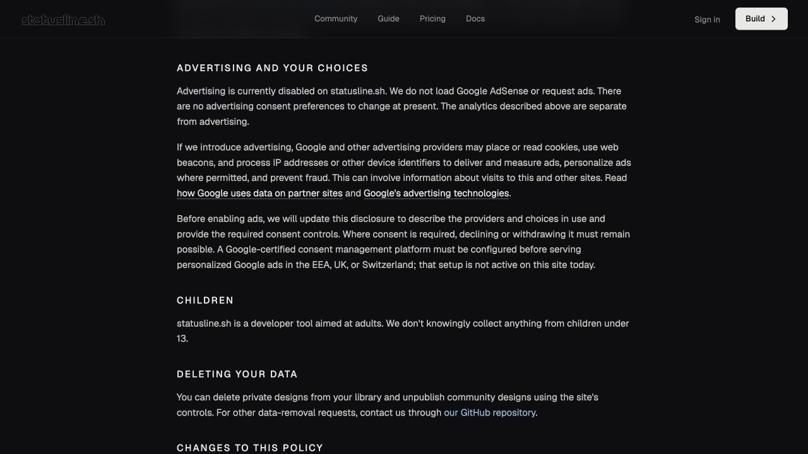
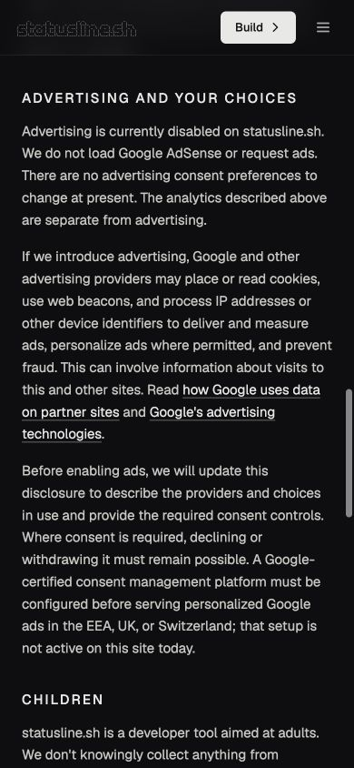
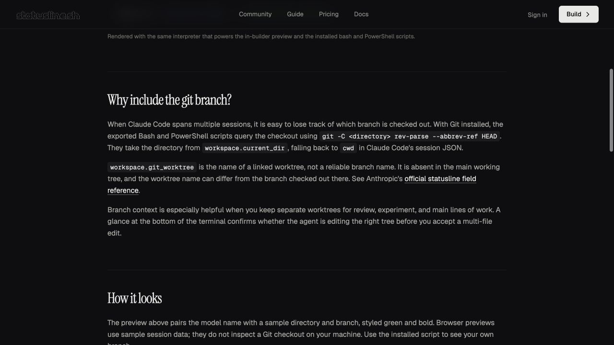
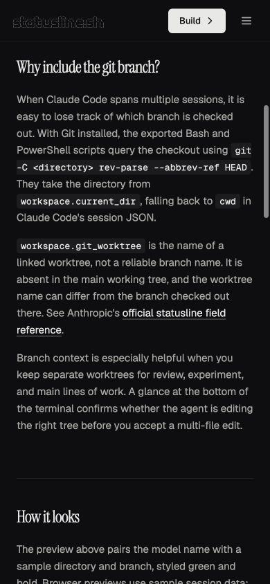
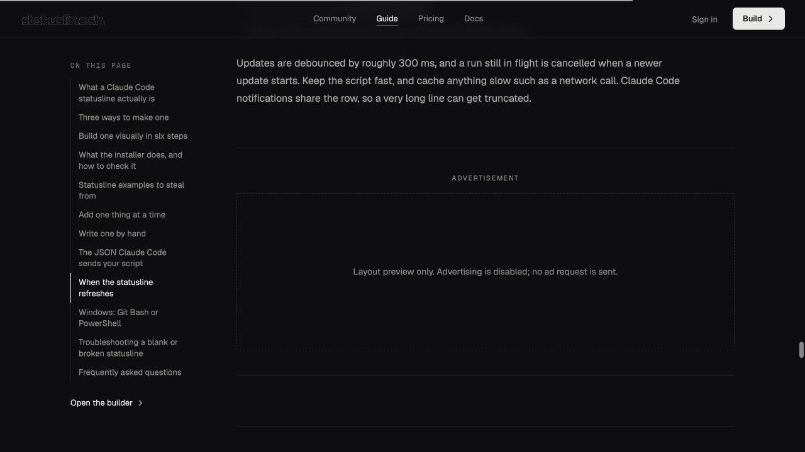
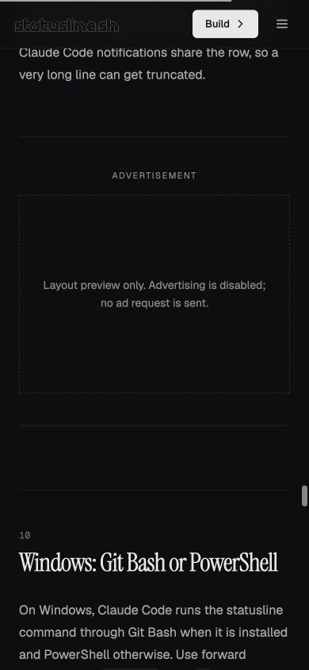

# AdSense readiness review — October 12, 2026

Local production build reviewed in an isolated Codex in-app browser at
1280 × 720 and 390 × 844. No shared Chrome tabs or airline sign-in group were
used. Screenshots below show the actual local build; the advertisement marker
is a localhost-only layout preview, not a live ad.

## Verification

- Full repository suite: 503 passed, 11 skipped (PowerShell executable absent).
- Focused final advertising/guide tests: 36 passed, 127 assertions.
- TypeScript 7.0.2 `tsc --noEmit`, `bun run build`, and `git diff --check`: passed.
  The repository has no lint script or configured linter.
- Desktop and mobile: privacy deep link and footer choice link, corrected
  branch text, and local placement layout. No horizontal overflow on these
  pages at either tested size.
- Normal tutorial: zero ad markers/AdSense elements, with the normal 80px
  section spacing rather than a reserved advertisement gap.
- Local layout preview: one marker after the refresh section; no links or
  controls inside it; 64px separation before it and 80px after it. The marker
  never loads an ad SDK. Deployment hostnames cannot opt into it.
- Builder, sign-in, pricing, community, missing detail, and unknown routes:
  zero markers or AdSense elements even with `?ad-preview=1`.
- Mobile builder: add an element, open/close install dialog; desktop builder:
  select the element, toggle styling, remove the temporary test element.
  Backend-dependent install command generation was not exercised in this
  static preview; the repository's installer integration tests passed.
- Real AdSense approval, live ad delivery, and CMP accept/decline/withdrawal
  cannot be tested until the account-side setup and a future integration exist.
  No account, consent, publisher, or production settings changed.

## Privacy disclosure

## Corrected Git branch guide

## Local placement preview — ads remain disabled

